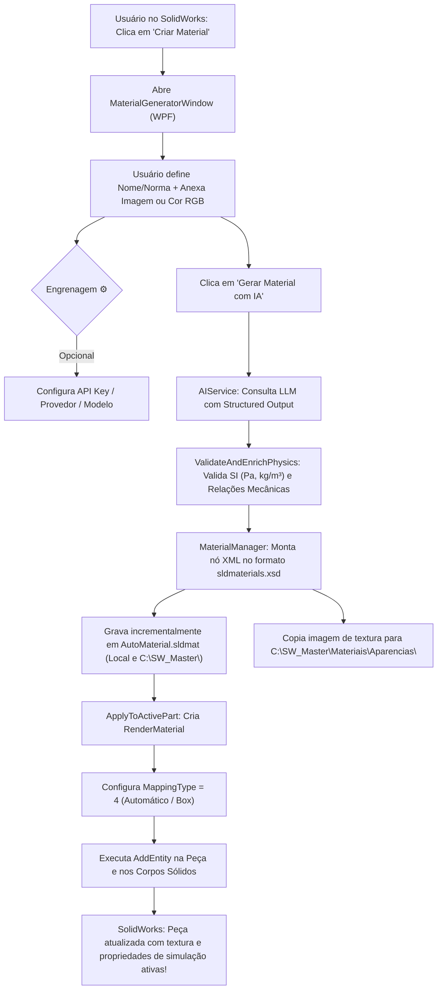

# Guia Completo de Arquitetura e Estrutura de Código — AutoMaterial

Bem-vindo ao **AutoMaterial** (`.NET Framework 4.8 / C# / WPF / SolidWorks API`), um Add-In nativo de alto nível para o Dassault Systèmes SolidWorks que utiliza Inteligência Artificial autônoma para pesquisar, enriquecer, validar e aplicar propriedades físicas de engenharia, modelos constitutivos CAE (FEA) e texturas fotorrealistas em peças 3D.

---

## 1. Visão Geral e Propósito

Tradicionalmente, a criação de materiais personalizados no SolidWorks é um processo manual, burocrático e suscetível a erros humanos (unidades erradas, propriedades térmicas ou de amortecimento zeradas que invalidam o solver de simulação, e bibliotecas bloqueadas que não permitem edição).

O **AutoMaterial** resolve esse gargalo com uma abordagem autônoma e elegante:
- O usuário fornece apenas o nome comercial, norma ou especificação do material (ex: `Aço AISI 4140 Temperado`, `Alumínio 7075-T6`, `MDF Cru`, `Nitrilo NBR 70 ShA`).
- A IA investiga a literatura técnica e normas (ASTM, ISO, DIN, ABNT, SAE), calculando com precisão todas as propriedades mecânicas, elásticas, térmicas e de amortecimento no Sistema Internacional de Unidades (SI).
- A interface gráfica adota os padrões **Apple Dark Minimalist** e a identidade visual de engenharia **AutoSolid (Dark Graphite & Crimson Red)**.
- O material é persistido em biblioteca `.sldmat` editável (ícone azul) e gravado em pastas estratégicas tanto locais quanto centralizadas (`C:\SW_Master\Materiais\`).
- A textura visual é vinculada à geometria do modelo 3D com **Mapeamento Automático (Box)** e aplicação instantânea na viewport sem exigir intervenções manuais.

---

## 2. Mapa Estrutural do Código Fonte

Abaixo está o mapeamento dos arquivos e pastas do projeto em `AutoMaterial\`:

```
c:\DevNinja\AutomationsSolidworks\AutoMaterial\
│
├── GUIA.md                               # Documento mestre de arquitetura (este arquivo)
│
└── AutoMaterial/
    ├── SwAddin.cs                        # Ponto de entrada do Add-In (COM / ISwAddin / Ribbon)
    ├── App.config                        # Configurações de runtime do .NET Framework 4.8
    ├── AutoMaterial.csproj               # Arquivo de compilação MSBuild / Referências do SolidWorks
    │
    ├── Assets/                           # Ícones e recursos visuais do Ribbon e janelas
    │   ├── AppIcon.ico / AppIcon.png     # Ícone oficial moderno (Apple/AutoMaterial)
    │   ├── AppIcon16.png .. 256.png      # Múltiplas resoluções PNG
    │   └── AutoMaterial16.bmp .. 128.bmp # Tiras de bitmap (stripes) do SolidWorks CommandManager
    │
    ├── Models/                           # Estruturas de dados e DTOs
    │   ├── MaterialProperties.cs         # Modelo de dados das propriedades físicas e térmicas (SI)
    │   └── MaterialAppearanceSelection.cs# Opções de renderização visual escolhidas pelo usuário
    │
    ├── Services/                         # Serviços de lógica de negócio e integração
    │   ├── AIService.cs                  # Orquestrador de IA (Gemini, OpenAI, DeepSeek, Validação Física)
    │   ├── MaterialManager.cs            # Manipulador do arquivo .sldmat (XML), RenderMaterial e SolidWorks API
    │   ├── TextureSearchService.cs       # Resolução e cópia de texturas (.jpg, .png) para diretórios do SW
    │   └── UserSettingsService.cs        # Persistência local segura de API Keys, provedores e modelos
    │
    └── Views/                            # Interface gráfica WPF de alta performance
        ├── MaterialGeneratorWindow.xaml  # Layout Apple Dark Minimalist com redimensionamento
        ├── MaterialGeneratorWindow.xaml.cs# Code-behind e orquestração de eventos
        ├── AppearanceSelectionWindow.xaml# Janela auxiliar de seleção de aparência
        └── AppearanceSelectionWindow.xaml.cs
```

---

## 3. Detalhamento dos Componentes Principais

### 3.1. Ponto de Entrada COM — [`SwAddin.cs`](file:///C:/DevNinja/AutomationsSolidworks/AutoMaterial/AutoMaterial/SwAddin.cs)
- **Interface Implementada**: `ISwAddin`.
- **Registro COM**: Contém os métodos estáticos decorados com `[ComRegisterFunction]` e `[ComUnregisterFunction]`, que escrevem nas chaves de registro do Windows (`HKLM\SOFTWARE\SolidWorks\Addins\{GUID}`).
- **Gerenciador de Comandos (CommandManager)**:
  - Cria dinamicamente a aba **"Ferramentas IA"** no CommandManager do SolidWorks (visível em documentos de Peça e Montagem).
  - Registra o comando **"Criar Material"** com ícone em múltiplas resoluções (`16x16`, `20x20`, `32x32`, `40x40`, `64x64`, `128x128`).
- **Gerenciamento de Instâncias**: Ao clicar no comando, instancia a [`MaterialGeneratorWindow`](file:///C:/DevNinja/AutomationsSolidworks/AutoMaterial/AutoMaterial/Views/MaterialGeneratorWindow.xaml), associando o ponteiro nativo `IWin32Window` (`swApp.IFrameObject()`) para que a janela WPF se comporte como filha modal nativa do SolidWorks.

---

### 3.2. Interface do Usuário (WPF) — [`MaterialGeneratorWindow.xaml`](file:///C:/DevNinja/AutomationsSolidworks/AutoMaterial/AutoMaterial/Views/MaterialGeneratorWindow.xaml) e [`.cs`](file:///C:/DevNinja/AutomationsSolidworks/AutoMaterial/AutoMaterial/Views/MaterialGeneratorWindow.xaml.cs)
- **Filosofia de Design**:
  - Padrão **Senior Apple Designer**: fundo escuro profundo (`#121214`), superfícies translúcidas em camadas card (`#1C1C20`), bordas suaves de alta definição (`#2C2C32`) e tipografia hierárquica clara (Segoe UI / SF Pro style).
  - Acentos de engenharia **AutoSolid**: gradiente carmesim acetinado (`#B81818` a `#981212`) nos botões de ação primária e badges.
- **Recursos Chave**:
  1. **Redimensionamento Fluido**: Atributos `ResizeMode="CanResizeWithGrip"`, `MinWidth="640"` e `MinHeight="720"` com scrollviewer integrado para adaptação perfeita a qualquer resolução ou monitor ultra-wide.
  2. **Gaveta de Configurações de IA Ocultável (Botão de Engrenagem `⚙️`)**:
     - No cabeçalho superior direito, um botão circular Apple de engrenagem substitui tags estáticas.
     - Clicar na engrenagem expande/recolhe o card de provedores (Gemini, OpenAI, DeepSeek), API Key e seleção de modelos (`cardAiSettings`).
     - Se o usuário tentar gerar um material sem configurar uma API Key, a gaveta se abre automaticamente e coloca o foco no campo de texto.
  3. **Visualizador de API Key**: Botão estilizado para alternar entre `PasswordBox` (pontos) e `TextBox` (texto legível).
  4. **Validação Estrita de Aparência Visual**:
     - O botão primário *"Gerar Material com IA"* permanece desabilitado (`IsEnabled="False"`) com tooltip informativo até que o usuário atenda aos critérios:
       - Um nome de material preenchido; **E**
       - Uma imagem de textura selecionada (`rbAttachImage`) **OU** a opção de cor pura RGB selecionada (`rbRgbOnly`).

---

### 3.3. Orquestrador de IA e Pesquisa Autônoma — [`AIService.cs`](file:///C:/DevNinja/AutomationsSolidworks/AutoMaterial/AutoMaterial/Services/AIService.cs)
- **Pesquisa Sem Tabelas Fixas**: A IA atua como um pesquisador autônomo, investigando a norma técnica ou nome comercial informado. O prompt não limita os valores a tabelas pré-moldadas, permitindo cobrir desde polímeros de engenharia até superligas aeroespaciais e madeiras tropicais.
- **Suporte Multi-Provedor**:
  - **Google Gemini**: Suporte nativo à API do Google AI Studio com Structured Outputs (`response_schema`), listagem dinâmica de modelos (`/v1beta/models`) e modelos recomendados de baixíssima latência (`gemini-3.5-flash-lite`, `gemini-2.5-flash`).
  - **OpenAI (GPT)**: Suporte aos modelos `gpt-4o-mini`, `gpt-4o`.
  - **DeepSeek**: Suporte ao endpoint OpenAI-compatible (`deepseek-chat`).
- **Validação e Sanidade Física em Código (`ValidateAndEnrichPhysics`)**:
  - **Massa Específica (Densidade)**: Checa se a ordem de grandeza em $kg/m^3$ condiz com a classe química do material (polímeros/madeiras nunca podem ser mais densos que metais pesados). Converte automaticamente $g/cm^3$ para $kg/m^3$ se necessário.
  - **Resistência Mecânica**: Garante que o Limite de Escoamento ($\sigma_y$) seja menor ou igual ao Limite de Resistência à Tração ($\sigma_{ut}$).
  - **Coeficiente de Poisson**: Normaliza para o intervalo termodinâmico admissível em sólidos ($0 < \nu < 0{,}50$).
  - **Módulo de Cisalhamento ($G$)**: Valida e sincroniza pela relação de isotropia elástica $G \approx \frac{E}{2(1+\nu)}$.
  - **Tolerância Zero a Valores Nulos**: Substitui eventuais zeros por estimativas proporcionais da classe, pois o solver de FEA do SolidWorks aborta estudos de simulação com grandezas zeradas.

---

### 3.4. Gerenciador de Materiais e SolidWorks API — [`MaterialManager.cs`](file:///C:/DevNinja/AutomationsSolidworks/AutoMaterial/AutoMaterial/Services/MaterialManager.cs)
Este é o coração técnico do Add-In, responsável pelo formato XML `.sldmat` e pela manipulação direta da árvore de feições e renderização da peça ativa.

#### A. Conformidade com o Schema `sldmaterials.xsd`
Para que o SolidWorks carregue o material sem avisos de integridade, as tags filhas de `<material>` são gravadas estritamente na ordem exigida pelo `<xsd:sequence>`:
1. `<shaders>` (renderização visual e caminhos de textura);
2. `<swatchcolor>` (matiz de cor no painel);
3. `<xhatch>` (padrão de corte 2D);
4. `<physicalproperties>` (todas as 10 propriedades elásticas e térmicas no SI);
5. `<custom>` (metadados com norma de origem, categoria e modelo constitutivo).

#### B. Biblioteca Personalizada Desbloqueada (Ícone Azul)
Diferente das bibliotecas padrão do sistema SolidWorks (que possuem os atributos restritos `matid` e `envdata` e geram o aviso *"Os materiais na biblioteca predeterminada não podem ser editados"*), o `MaterialManager`:
- Remove intencionalmente `matid` e `envdata`.
- Permite que o engenheiro altere o **Tipo de Modelo** ou qualquer parâmetro na tela de materiais do SolidWorks e clique em **Salvar** livremente.

#### C. Estratégia de Salvamento em Pastas Duplas
O método `CreateAndApplyMaterial` salva o arquivo de forma incremental em dois locais estratégicos e os registra nas opções globais do SolidWorks (`swFileLocationsMaterialDatabases` e `swFileLocationsTextures`):
1. **Pasta Padrão Local**:
   - `C:\Users\<Usuario>\Documents\AutoMaterial\AutoMaterial.sldmat`
   - Texturas: `C:\Program Files\SOLIDWORKS Corp\SOLIDWORKS\data\Images\materials-ia\` (com fallback para `Documents\AutoMaterial\Textures\`).
2. **Diretório Mestre Centralizado**:
   - Materiais: `C:\SW_Master\Materiais\Materiais\AutoMaterial.sldmat`
   - Aparências/Texturas: `C:\SW_Master\Materiais\Aparencias\<Material>_texture.ext`

#### D. Vínculo de Textura e Mapeamento Automático (`ApplyToActivePart`)
O vínculo visual imediato na peça ativa utiliza o motor `RenderMaterial` do SolidWorks:
- **`renderMat.MappingType = 4`**: Define o tipo de projeção como **Automático (Box Mapping)**, garantindo que a imagem seja projetada uniformemente em todas as faces da geometria sem exigir ajustes manuais de UV.
- **`renderMat.AddEntity(modelDoc)` e `renderMat.AddEntity(solidBody)`**: Vincula explicitamente o material à geometria da peça e aos corpos sólidos. Esta chamada foi o diferencial técnico que eliminou a necessidade de o usuário ter que abrir a tela de edição de aparência e clicar em ✔️ para validar a textura.
- **Display States**: Registra o material em todos os estados de exibição com `AddDisplayStateSpecificRenderMaterial`.

---

### 3.5. Modelos de Dados — [`Models\`](file:///C:/DevNinja/AutomationsSolidworks/AutoMaterial/AutoMaterial/Models/)
- **[`MaterialProperties.cs`](file:///C:/DevNinja/AutomationsSolidworks/AutoMaterial/AutoMaterial/Models/MaterialProperties.cs)**: DataContract JSON com mapeamento de todas as grandezas físicas (`EX`, `NUXY`, `GXY`, `DENS`, `SIGXT`, `SIGXC`, `SIGYLD`, `ALPX`, `KX`, `C`, `MDAMP`), modelo constitutivo (`model_type`), norma de origem (`property_source`) e cor RGB.
- **[`MaterialAppearanceSelection.cs`](file:///C:/DevNinja/AutomationsSolidworks/AutoMaterial/AutoMaterial/Models/MaterialAppearanceSelection.cs)**: Encapsula a intenção do usuário quanto à aparência visual (se usará textura importada de arquivo local, se usará apenas a cor RGB pura, ou shader nativo).

---

### 3.6. Persistência de Configurações — [`UserSettingsService.cs`](file:///C:/DevNinja/AutomationsSolidworks/AutoMaterial/AutoMaterial/Services/UserSettingsService.cs)
- Grava em `C:\Users\<Usuario>\AppData\Roaming\AutoMaterial\settings.json`.
- Isola as chaves de API por provedor (Gemini, OpenAI, DeepSeek), lembrando a última chave utilizada, o provedor ativo e o último modelo de IA selecionado.

---

## 4. Fluxo Completo de Execução



---

## 5. Como Compilar e Testar

### Pré-requisitos
- Microsoft Visual Studio 2019/2022 ou MSBuild tools.
- .NET Framework 4.8 Developer Pack.
- SolidWorks instalado na máquina (as referências de interoperabilidade `SolidWorks.Interop.sldworks` e `SolidWorks.Interop.swconst` estão configuradas com `EmbedInteropTypes = False`).

### Linha de Comando (PowerShell)
```powershell
# Compilar projeto em modo Debug
& "C:\Program Files\Microsoft Visual Studio\18\Community\MSBuild\Current\Bin\MSBuild.exe" "AutoMaterial\AutoMaterial.csproj" /t:Build /p:Configuration=Debug /v:minimal
```

> [!NOTE]
> Se o SolidWorks estiver aberto em execução com o Add-In carregado, o arquivo `bin\Debug\AutoMaterial.dll` estará bloqueado em memória pelo processo `SLDWORKS.exe`. Para recompilar, feche o SolidWorks ou desative o Add-In temporariamente na janela de Suplementos do SolidWorks.

---

## 6. Dicas de Navegação no Código

- **Dúvidas sobre o prompt de física ou JSON enviado à IA?**
  Consulte [`AIService.cs` (linha 47)](file:///C:/DevNinja/AutomationsSolidworks/AutoMaterial/AutoMaterial/Services/AIService.cs#L47).
- **Dúvidas sobre como o XML `.sldmat` é gerado ou a ordem das propriedades?**
  Consulte [`MaterialManager.cs` (linha 225)](file:///C:/DevNinja/AutomationsSolidworks/AutoMaterial/AutoMaterial/Services/MaterialManager.cs#L225).
- **Dúvidas sobre como a textura foi aplicada sem precisar dar ✔️ no SolidWorks?**
  Consulte [`MaterialManager.cs` (linha 1100)](file:///C:/DevNinja/AutomationsSolidworks/AutoMaterial/AutoMaterial/Services/MaterialManager.cs#L1100).
- **Dúvidas sobre a paleta visual, estilos de botões ou estrutura XAML?**
  Consulte [`MaterialGeneratorWindow.xaml`](file:///C:/DevNinja/AutomationsSolidworks/AutoMaterial/AutoMaterial/Views/MaterialGeneratorWindow.xaml).
