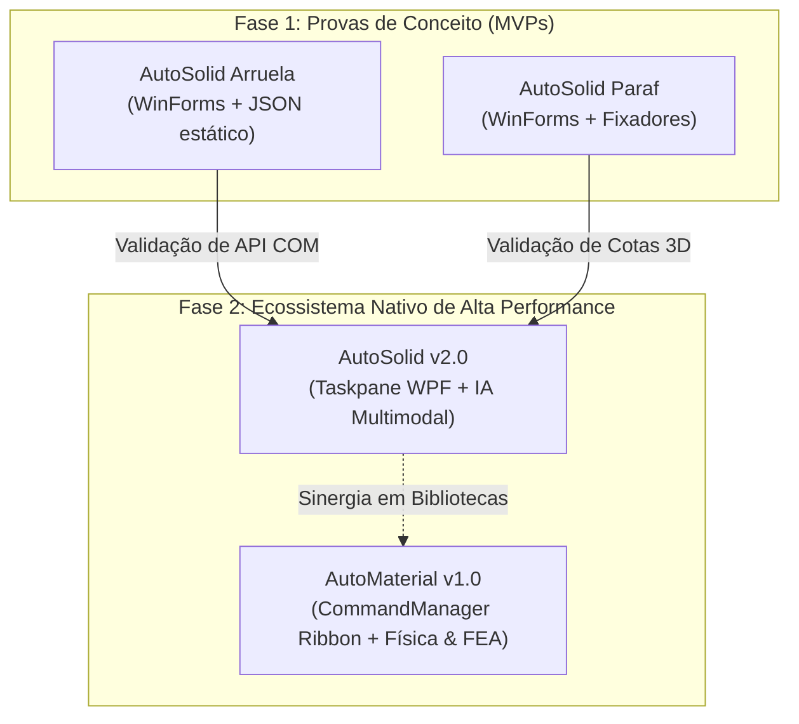
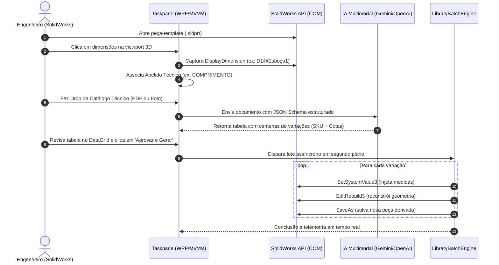
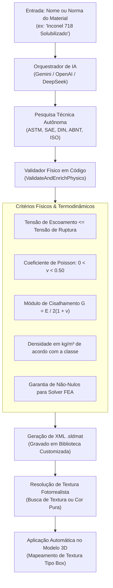

# ⚙️ AutoSolid Suite — Automações Inteligentes para SolidWorks CAD

[](https://www.solidworks.com/)
[](https://dotnet.microsoft.com/)
[](https://learn.microsoft.com/dotnet/desktop/wpf/)
[](https://ai.google.dev/)
[](https://platform.openai.com/)

Suite avançada de automação paramétrica, geração autônoma de bibliotecas 3D e engenharia de materiais assistida por **Inteligência Artificial Multimodal** para o **Dassault Systèmes SolidWorks**.

---

## 📑 Sumário

- [Visão Geral](#-visão-geral)
- [Linha do Tempo e Evolução dos Projetos](#-linha-do-tempo-e-evolução-dos-projetos)
- [Aplicações Principais em Destaque](#-aplicações-principais-em-destaque)
  - [1. AutoSolid (Add-In Nativo com IA Multimodal)](#1--autosolid-add-in-nativo-com-ia-multimodal)
  - [2. AutoMaterial (Criador Autônomo de Materiais & FEA)](#2--automaterial-criador-autônomo-de-materiais--fea)
- [Aplicações MVP de Validação](#-aplicações-mvp-de-validação)
  - [3. AutoSolid Paraf (MVP)](#3--autosolid-paraf-mvp-de-validação)
  - [4. AutoSolid Arruela (MVP)](#4--autosolid-arruela-mvp-de-validação)
- [Matriz Comparativa entre as Aplicações](#-matriz-comparativa-entre-as-aplicações)
- [Segurança, Credenciais e API Keys](#-segurança-credenciais-e-api-keys)
- [Pré-requisitos e Instalação](#-pré-requisitos-e-instalação)
- [Licença e Autor](#-licença-e-autor)

---

## 🚀 Visão Geral

A **AutoSolid Suite** foi concebida para eliminar tarefas manuais e repetitivas em escritórios de engenharia, projetos de ferramentaria e linhas de manufatura. Integrando a **SolidWorks API nativa (COM)** com modelos de ponta em Inteligência Artificial generativa, a suíte permite:

1. **Modelagem Paramétrica Inteligente em Lote:** Ingestão de catálogos em PDF ou imagens e reconstrução 3D automática de famílias inteiras de componentes (.SLDPRT).
2. **Engenharia de Materiais Orientada por IA:** Pesquisa autônoma de propriedades constitutivas (mecânicas, térmicas e elásticas) para simulação de elementos finitos (FEA/CAE), com fotorrealismo visual instantâneo e integração com arquivos `.sldmat`.



---

## 📈 Linha do Tempo e Evolução dos Projetos

Antes de consolidar uma plataforma universal, foram desenvolvidos **dois MVPs (Minimum Viable Products)** dedicados para validar as capacidades de interoperabilidade com o SolidWorks:

1. **AutoSolid Arruela (1º MVP):** Provou que era possível alterar dimensões básicas de espessura e diâmetros em modelos pré-existentes através de arrays de dados estruturados.
2. **AutoSolid Paraf (2º MVP):** Validou a orquestração de cotas geométricas mais complexas em fixadores (rosca, chave sextavada, altura da cabeça e comprimento útil).
3. **AutoSolid (Plataforma Consolidada):** Unificou as lições aprendidas nos MVPs, removendo todas as amarras de código fixo (*hardcoded*). Substituiu a interface legada por um **Taskpane nativo em WPF/MVVM**, adicionou **seleção visual de cotas** e introduziu a **extração automática de dados de catálogos via IA Multimodal**.
4. **AutoMaterial (Expansão de Domínio):** Levou a IA para além da geometria, automatizando a criação de propriedades de materiais, física de simulação e texturas visuais.

---

## 🌟 Aplicações Principais em Destaque

---

### 1. 💎 AutoSolid (Add-In Nativo com IA Multimodal)

> **Tipo:** Add-In Nativo do SolidWorks (DLL COM)  
> **Localização:** Barra Lateral de Ferramentas (**Taskpane**)  
> **Tecnologias:** C#, .NET Framework 4.8, WPF, XAML, MVVM, Google Gemini API, OpenAI, DeepSeek.

O **AutoSolid** é a evolução definitiva da automação paramétrica de peças. Ele se ancora diretamente na interface lateral do SolidWorks, permitindo que o projetista transforme qualquer peça aberta em uma matriz paramétrica viva.



#### ✨ Recursos Exclusivos do AutoSolid:
- **Detecção de Modelo Ativo:** Conecta-se automaticamente ao documento `.sldprt` em edição, sem exigir caminhos estáticos ou configurações manuais.
- **Mapeador Interativo de Cotas 3D:** O usuário clica na cota na tela ou na árvore de projetos; o sistema captura o endereço interno (`swDim.FullName`) e permite atribuir um apelido semântico (ex: `L`, `DIAM_EXT`, `CHAVE`).
- **Extração com Inteligência Artificial Multimodal:**
  - Suporte ao **Google Gemini (2.5 Flash, 3.5 Flash Lite, 3.8 Flash)** com *Structured Outputs (JSON Schema)* e fallback resiliente de 3 níveis.
  - Suporte a provedores compatíveis com OpenAI (incluindo **DeepSeek**).
  - Dicionário de equivalência de engenharia embutido (reconhece normas ISO, DIN, ANSI e termos técnicos em catálogos complexos).
- **Modo Padrão & Modo Perfil:** Permite chavear entre geração de peças normais e perfis estruturais com ajustes paramétricos sob medida.
- **Design System Moderno:** Interface escura e clara (Dark / Light Mode) inspirada em padrões Apple/Cad, com DataGrid dinâmico, animações fluidas e painel retrátil de logs com diagnóstico técnico.
- **Motor Silencioso com Gerenciamento de Memória COM:** Liberação estrita de recursos não-gerenciados (`Marshal.ReleaseComObject` e `ComReleaseHelper`) para evitar instâncias presas de `SLDWORKS.exe`.

---

### 2. 🧪 AutoMaterial (Criador Autônomo de Materiais & FEA)

> **Tipo:** Add-In Nativo do SolidWorks (DLL COM)  
> **Localização:** Faixa Superior de Comandos (**Ribbon / CommandManager**), aba *"Ferramentas IA"*  
> **Tecnologias:** C#, .NET Framework 4.8, WPF, XAML, XML Manipulation, SolidWorks RenderMaterial API.

Criar materiais manualmente no SolidWorks é um processo lento e arriscado: campos deixados em branco ou em unidades erradas (como coeficientes térmicos ou de amortecimento) provocam falhas fatais no solver de **Simulação por Elementos Finitos (FEA)**.

O **AutoMaterial** resolve isso completamente. O usuário informa apenas o nome ou especificação técnica do material (ex: `Aço AISI 4140 Temperado`, `Alumínio 7075-T6`, `Nylon PA6 com 30% FV`, `Cobre ETP`), e a aplicação cuida do restante.



#### ✨ Recursos Exclusivos do AutoMaterial:
- **Pesquisa Sem Tabelas Fixas:** A IA pesquisa literatura técnica em tempo real, cobrindo de superligas aeroespaciais a polímeros avançados e elastômeros.
- **Validação de Sanidade Física:**
  - Corrige ordens de grandeza e normaliza para o **Sistema Internacional (SI)**.
  - Verifica coerência elástica isotrópica ($G \approx \frac{E}{2(1+\nu)}$).
  - Impede que materiais com dados zerados entrem na biblioteca, garantindo compatibilidade total com o **SolidWorks Simulation**.
- **Renderização Visual Automática:** Aplica a cor RGB procedural ou localiza/associa texturas de imagem fotorrealistas mapeadas via algoritmo de projeção tipo *Box* na peça ativa.
- **Bibliotecas `.sldmat` Prontas para Uso:** Adiciona os materiais gerados a bibliotecas de materiais customizadas editáveis (identificadas pelo ícone azul no SolidWorks).
- **Interface Apple Dark Minimalist:** Janela flutuante modal com estética refinada, gaveta retrátil de configurações de provedores de IA e visualizador de API Key.

---

## 🛠️ Aplicações MVP de Validação

Os dois projetos abaixo foram desenvolvidos como **Provas de Conceito (MVPs)** em Windows Forms (.exe) para validar hipóteses de arquitetura antes do desenvolvimento do AutoSolid principal:

---

### 3. 🔩 AutoSolid Paraf (MVP de Validação)
- **Objetivo:** Validar a modificação programática de cotas tridimensionais interdependentes em parafusos sextavados via SolidWorks API.
- **Como Funciona:**
  1. Conecta-se à instância aberta do SolidWorks via `Marshal.GetActiveObject("SldWorks.Application")`.
  2. Abre o arquivo template `Parafuso_Base.SLDPRT`.
  3. Lê um arquivo local `Parametros.json` contendo variações de diâmetro, comprimento útil, tamanho da cabeça sextavada e altura da cabeça.
  4. Localiza as cotas do modelo (`DiamRosca@Esboço1`, `Comprimento@Ressalto-extrusão1`, etc.), aplica os novos valores com `SetSystemValue3`, executa `EditRebuild3` e exporta cada variante gerada para uma pasta de destino.
- **Legado:** Forneceu a base lógica para o motor `LibraryBatchEngine` do AutoSolid atual.

---

### 4. 🔘 AutoSolid Arruela (MVP de Validação)
- **Objetivo:** Validar a automação básica de geometria circular e espessura em arruelas lisas padrão.
- **Como Funciona:**
  1. Carrega o template `ARRUELA_STD.SLDPRT`.
  2. Desserializa o arquivo `arruela.json` com parâmetros de diâmetro externo, diâmetro interno e espessura.
  3. Altera as cotas correspondentes e salva os arquivos derivados.
- **Legado:** Validou os tempos de resposta da API do SolidWorks para peças de alta rotação e baixo número de recursos.

---

## 📊 Matriz Comparativa entre as Aplicações

| Característica | AutoSolid Arruela (MVP) | AutoSolid Paraf (MVP) | AutoSolid (Principal) | AutoMaterial (Principal) |
|---|---|---|---|---|
| **Arquitetura** | Executável (.exe) WinForms | Executável (.exe) WinForms | Add-In Nativo (.dll COM) WPF | Add-In Nativo (.dll COM) WPF |
| **Integração no SW** | Conexão Externa | Conexão Externa | Painel Lateral (**Taskpane**) | Barra de Comandos (**Ribbon**) |
| **Padrão de Projeto** | Procedural / Event-driven | Procedural / Event-driven | **MVVM** estrito | **MVVM / Service-Oriented** |
| **Entrada de Dados** | `arruela.json` local estático | `Parametros.json` estático | **IA Multimodal (PDF/Imagens)** ou manual | **Prompt / Nome do Material via IA** |
| **Flexibilidade de Peça**| Apenas arruelas específicas | Apenas parafusos específicos | **Qualquer peça .sldprt ativa** | **Qualquer peça ou montagem ativa** |
| **Cotas do Modelo** | Fixas no código (*hardcoded*) | Fixas no código (*hardcoded*) | **Mapeamento dinâmico via clique** | N/A (Foco em materiais e texturas) |
| **Inteligência Artificial**| ❌ Não | ❌ Não | ✅ Gemini / OpenAI / DeepSeek | ✅ Gemini / OpenAI / DeepSeek |
| **Simulação FEA** | ❌ Não | ❌ Não | ❌ Não | ✅ Propriedades Físicas e CAE |
| **Aparência Visual** | ❌ Não | ❌ Não | ❌ Não | ✅ Texturas e Mapeamento Box |

---

## 🔒 Segurança, Credenciais e API Keys

A suíte utiliza modelos avançados de Inteligência Artificial que exigem chaves de API (**API Keys**) para os serviços do **Google AI Studio (Gemini)**, **OpenAI** ou **DeepSeek**.

### 🛡️ Onde as chaves são armazenadas?
Para proteger o usuário contra vazamentos acidentais de credenciais em repositórios públicos:
- As aplicações **AutoSolid** e **AutoMaterial** **NÃO** salvam suas chaves de API na pasta do código-fonte ou no repositório.
- A persistência é feita exclusivamente no diretório local do usuário do Windows (`%APPDATA%`):
  - AutoSolid: `%APPDATA%\AutoSolid\settings.json`
  - AutoMaterial: `%APPDATA%\AutoMaterial\settings.json`

### 🚫 Proteção do `.gitignore`
O repositório está configurado com regras rígidas de segurança para impedir o versionamento de qualquer dado sensível:
- `settings.json`, `*.settings.json`, `secrets.json`, `.env` e arquivos com padrões de chaves e segredos.
- Arquivos de sessão do Visual Studio (`.vs/`), incluindo históricos de chat do GitHub Copilot que possam registrar trechos privados de código ou conversas.
- Binários intermediários e arquivos temporários de compilação (`*.cache`, `*.FileListAbsolute.txt`, etc.).

---

## 💻 Pré-requisitos e Instalação

### Pré-requisitos
- **Sistema Operacional:** Windows 10 ou Windows 11 (64-bit).
- **CAD:** Dassault Systèmes **SolidWorks** (2020 a 2026).
- **Ambiente de Execução:** [.NET Framework 4.8 Runtime](https://dotnet.microsoft.com/download/dotnet-framework/net48).
- **Compilação / Desenvolvimento:** Visual Studio 2022 ou superior com suporte a cargas de trabalho para desktop .NET.
- **Chave de API de IA:**
  - [Google AI Studio](https://aistudio.google.com/) (Chave gratuita recomendada para o Gemini).
  - [OpenAI Platform](https://platform.openai.com/) ou [DeepSeek Platform](https://platform.deepseek.com/).

---

### Passo a Passo de Instalação e Registro dos Add-Ins

#### 1. Clonar o Repositório
```bash
git clone https://github.com/SEU_USUARIO/AutomationsSolidworks.git
cd AutomationsSolidworks
```

#### 2. Compilar os Projetos
Abra os arquivos de solução no Visual Studio:
- `AutoSolid/AutoSolid.sln`
- `AutoMaterial/AutoMaterial.slnx`

Compile ambos em configuração **Release** (ou **Debug** para testes locais).

#### 3. Registrar os Suplementos no Windows / SolidWorks
Execute o script de registro como **Administrador**:
- Para o AutoSolid: Clique com o botão direito em `AutoSolid/RegisterAddIn.bat` e selecione **"Executar como Administrador"**.
- Para o AutoMaterial: Registre a DLL via comando RegAsm 64-bit:
```powershell
# Executar no PowerShell como Administrador:
C:\Windows\Microsoft.NET\Framework64\v4.0.30319\regasm.exe /codebase "AutoMaterial\AutoMaterial\bin\Debug\AutoMaterial.dll"
```

#### 4. Ativação no SolidWorks
1. Inicie o SolidWorks.
2. Acesse o menu **Ferramentas** > **Suplementos...** (*Tools > Add-Ins...*).
3. Localize **AutoSolid** e **AutoMaterial** e marque as caixas de seleção para carregamento ativo e na inicialização.
4. Abra o painel lateral (**Taskpane**) para utilizar o AutoSolid ou a aba **"Ferramentas IA"** no topo da tela para utilizar o AutoMaterial.
5. Clique no ícone de configurações (⚙️) em cada ferramenta e cole sua chave de API para habilitar as funções inteligentes.

---

## 📄 Licença e Autor

Desenvolvido por **Vitor Eduardo Garcia** ([@vitorgarcia-cloud](https://github.com/vitorgarcia-cloud)).  
Projeto destinado a automação e inovação contínua no ecossistema CAD da engenharia mecânica.

